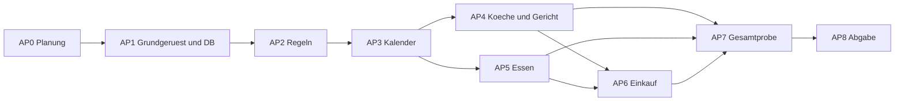

# Projektplan — Der kulinarische Mittwoch
Stand 22.10.2026 · Einzelarbeit · AP1–AP4 technisch geprüft; AP5–AP8 offen.

## Ziel und Steuerung
Erst vollständiger MUSS-Durchstich, dann Abnahme und erst danach zusätzlicher Sollumfang. Kein Kalenderexport oder Deployment auf Kosten von M1–M8. Die Aufwandsschätzung gilt für die Bauphase ab vorhandenem Plan, nicht als nachträglicher Tätigkeitsnachweis. Testzeiten sind in den Paketen enthalten; AP7 führt die Integration und Gesamtprobe zusammen.

## Arbeitspakete
| Paket | Ergebnis und Schritte | Abhängigkeit | Budget | Gegenprobe / Fertigkriterium | Zuordnung |
|---|---|---|---:|---|---|
| AP0 | Quellen, Lasten-/Pflichtenheft, MoSCoW, Entscheidungen und Diagramme prüfen | keine | Dokumentationsauftrag dieser Sitzung | vollständige M/S/C/W-Matrix, lokale Links auflösbar, kein falscher App-Status | Dokumente |
| AP1 | Python/Abhängigkeiten prüfen; Flask-Grundgerüst, Schema, lokaler Start; DB-Pfad und temporäre Tests | AP0 | 20 min | frischer Start, Daten schreiben, Prozess neu starten und dieselben Daten lesen; leere DB initialisiert ohne bestehende zu löschen | M8 |
| AP2 | Reine Regeln bauen: Mittwoch, cutoff, Name, Kochgrenze; Clock injizieren | AP1 | 25 min | Winter/Sommer jeweils vor/exakt/nach Frist; Anna-Duplikat; Nicht-Mittwoch; dritter Koch verboten | M2/M5/M6 |
| AP3 | Monatskalender und Detailansicht; beliebige Monatsnavigation und lazy Termine | AP1, AP2 | 25 min | Jahreswechsel, Schaltjahr, Mittwoch 24 Monate später; leeres Gericht stört Buchbarkeit nicht | M1 |
| AP4 | Koch-Ein/Austragen und Gericht-Formular mit serverseitiger Validierung | AP2, AP3 | 25 min | zwei Köche, dritter/gleichzeitiger dritter abgewiesen; Austragen; Gericht roundtrip; fehlender Titel abgewiesen | M2/M3 |
| AP5 | Essen-An/Abmeldung, normalisierter Schlüssel und sichtbare Sperre | AP2, AP3 | 25 min | Anna/anna am selben Tag verboten, anderer Tag erlaubt; Hinweis optional; direkter POST nach Frist verboten | M4/M5/M6 |
| AP6 | Einkaufsansicht mit Gesamtzahl, disjunkten Ernährungszahlen und Hinweisen | AP4, AP5 | 15 min | Testbestand 2 alles + 1 vegetarisch + 1 vegan → 4; Koch ohne Anmeldung zählt nicht | M7 |
| AP7 | Gezielte Tests zusammenführen, lokaler Checkbericht, Browser-Durchstich, Fehler beheben | AP4, AP5, AP6 | 25 min | Testlauf mit temporärer DB und Neustart; Kalender → Koch → Gericht → Essen → Einkauf; alle A-M-Fälle prüfen | M1–M8 |
| AP8 | README-Start in höchstens 3 Befehlen verifizieren; Journal/Abnahme ausfüllen; Abgabezustand sichern | AP7 | 15 min | neuer Ordner/saubere Umgebung, Start und Datenbestand; keine ungeprüften Haken; Code-Freeze eingehalten | Abgabe |
| Puffer | Nur Defekte, Installation und Abnahmeunsicherheit | bei Bedarf | 15 min | Ursache und Verbrauch im Journal, keine neuen Features | Risiken |

**MUSS-Bauphase: 175 Minuten + 15 Minuten Puffer = 190 Minuten.** AP4/AP5 sind fachlich getrennt, werden bei Einzelarbeit nacheinander umgesetzt. Parallele Kästchen im Diagramm sind keine doppelt verfügbare Arbeitszeit.

## Abhängigkeiten

## Rückwärtsplan ab 17:00 Uhr
Das Blatt nennt kein Veranstaltungsdatum und keine Startzeit. Folgende Uhrzeiten sind ein **bedingtes Szenario mit Beginn 13:50 Uhr**, keine Aussage über die aktuelle Uhrzeit oder tatsächlich geleistete Arbeit. Europe/Berlin gilt für die Darstellung.

| Zeitfenster | Paket | Kontrollpunkt |
|---|---|---|
| 13:50–14:10 | AP1 | lokaler Start + erste Neustartprobe |
| 14:10–14:35 | AP2 | Zeit- und Identitätsregeln geprüft |
| 14:35–15:00 | AP3 | navigierbarer Kalender |
| 15:00–15:25 | AP4 | Koch/Gericht speicherbar |
| 15:25–15:50 | AP5 | Anmeldung einschließlich Sperre |
| 15:50–16:05 | AP6 | vollständiger MUSS-Durchstich |
| 16:05–16:30 | AP7 | integrierte Gegenprobe und Fehlerbehebung |
| 16:30–16:45 | Puffer | letzte MUSS-Defekte |
| 16:45–17:00 | AP8 | Freeze, README, Journal, Checkliste |
Bei späterem Start ist das Budget größer als die Restzeit. Dann keine Soll- oder Kann-Funktionen beginnen; optional bis maximal 17:30 verlängern und begründen. Reicht auch das nicht, Restumfang ehrlich offen ausweisen. Niemals fehlende MUSS-Punkte als erledigt markieren.

## Meilensteine und Ausstiegskriterien
| Meilenstein | Nachweis | Entscheidung bei Nichterreichen |
|---|---|---|
| MS0 Planung vorhanden | Anforderungen und Entscheidungen lesbar | vor Code Widersprüche auflösen |
| MS1 Fundament | AP1/AP2 erfolgreich | keine Oberfläche als Ersatz für defekte Regeln ausbauen |
| MS2 MUSS-Durchstich | AP3–AP6 im Browser ausführbar | zusätzliche Features streichen, Defekte bearbeiten |
| MS3 technisch geprüft | AP7-Bericht für genau diesen Stand | Fehlerliste priorisieren; keine technische Fertigmeldung |
| MS4 Abgabefähig | AP8, alle Must-Fälle mit Nachweis, Journal | offene Abnahme/Fehler sichtbar mitliefern |

## Soll- und Kann-Backlog nach MS3
| Reihenfolge | Paket | Budget zusätzlich | Abhängigkeit und Gegenprobe |
|---|---|---:|---|
| 1 | S1 Kochstatus | 5 min | AP4; Zustände 0/1/2 |
| 2 | S5 mobile Bedienbarkeit | 15 min | AP3–AP6; 375-px-Browserprüfung |
| 3 | S4 Historie | 10 min | AP2/AP3; Lesen möglich, POST auf Vergangenheit gesperrt |
| 4 | S3 Absage mit Grund | 15 min | AP4–AP6; Daten bleiben, aktive Einkaufssumme 0, auch nach Frist absagbar |
| 5 | S2 Limit und FIFO-Warteliste | 30 min | AP5/AP6; atomare Kapazität, Nachrücken, Frist, Limitänderung |
Soll-Budget gesamt 75 Minuten, nicht im 190-Minuten-MUSS-Szenario enthalten. Nur ein Paket beginnen, wenn zusätzlich Zeit für Gegenprobe und AP8 bleibt. C1 vor C3 vor C2; C4/C5 nur mit eigener Versand-/Betriebsklärung. Could-Aufwände erst bei Auswahl schätzen, derzeit keine Zusage.

## Risiken und Maßnahmen
| Risiko | Eintritt / Auswirkung | Vorbeugung | Reaktion |
|---|---|---|---|
| Zeit reicht nicht | hoch / hoch | 17-Uhr-Rückwärtsplan, fester Abgabeblock | S/C weglassen, maximal 17:30 begründet, Rest offen |
| Zeitzone/Windows-Daten fehlen | mittel / hoch | tzdata, feste Winter-/Sommer-Gegenproben in AP2 | Start mit klarer Fehlermeldung, keine falsche Frist |
| Rennen bei Doppelanmeldung/Kochgrenze | mittel / hoch | Unique-Schlüssel + atomare Transaktion | Konflikt ohne Teilzustand anzeigen |
| Persistenz nur scheinbar | mittel / hoch | AP1 und AP7 mit echtem Prozessneustart | DB-Pfad korrigieren, kein In-Memory-Ersatz |
| KI produziert falsche Erfolge | mittel / hoch | Resultat gegen konkrete Probe abnehmen | Schritt offen/fehlgeschlagen dokumentieren |
| Neue Anforderungen unterwegs | laut Blatt möglich / hoch | Change-Eintrag mit M/S/C/W und Aufwand | Auftrag/Plan vor Code nachführen, Auswirkung nennen |
| Claude-Plugins vorhanden, Hooks unwirksam | ungeprüft / mittel | explizite Prüfkommandos statt implizitem Vertrauen | separater Diagnoseauftrag; aktuelle Settings unverändert |

## Änderungs- und Berichtsregel
Pro Änderung: Datum, Quelle, neue Anforderung, Priorität, Aufwand, betroffene Pakete/Tests, Entscheidung im Journal. Alle tatsächlichen Arbeitssitzungen mit 2–3 Zeilen etwa alle 30 Minuten. Planzeiten niemals als Ist-Zeiten übernehmen. Belege unter test-results/ oder .harness/ lokal halten; fachlichen Abnahmestand separat ausweisen.

## Ursprünglicher erster Bauauftrag (AP1 inzwischen ausgeführt)
AP1 ausführen: ausschließlich Grundgerüst, SQLite-Schema und lokale Startfähigkeit gemäß Pflichtenheft. Gegenprobe: Datensatz in temporärem Bestand anlegen, Prozess neu starten, Zustand erneut lesen; frischer Start darf vorhandene Daten nicht löschen. Danach AP2, bevor Koch-/Essensanmeldungen gebaut werden. Keine Commits oder Pushes ohne passenden Auftrag.

## Fortschritt — 22.10.2026, nach AP1
- AP0: Dokumentation vorhanden und geprüft.
- AP1: umgesetzt, 14 Tests erfolgreich, echter Prozessneustart und Datenerhalt nachgewiesen; QS-Check mit positivem und absichtlich negativem Lauf eingerichtet. Nachweis: [AP1-QS](07-ap1-qs.md).
- AP2–AP8: offen. MS1 benötigt auch AP2 und ist noch nicht erreicht. AP7-Gesamtprüfung und A-M8-Produktfall bleiben offen; der AP1-Persistenztest ersetzt keine Bedienung über erst noch zu bauende Fachformulare.
Nächster konkreter Auftrag ist AP2: reine Regeln für Datum, Dienstagsschluss, Namensnormalisierung und Kochgrenze mit injizierter Uhr; positive und negative Gegenproben gemäß Plan.

## Fortschritt — 22.10.2026, nach AP2
AP2 umgesetzt und mit 51 neuen Regel-/Clock-/Guardrail-Fällen geprüft; zusammen mit AP1 65 Tests grün. **MS1 Fundament erreicht.** Details: [AP2-QS](08-ap2-qs.md). Die Logik ist noch nicht an fachliche Schreibendpunkte angeschlossen; M2/M5/M6 bleiben als Gesamtproduktfälle offen.
Nächster Auftrag AP3: Monatskalender mit Montag als Wochenanfang, hervorgehobenen Mittwochen, frei berechneter Monatsnavigation und lesender Detailansicht; keine Begrenzung auf vorbereitete Datenbanktermine. Gegenproben: Dezember/Januar, Schaltjahr und Mittwoch 24 Monate später ohne Datensatz. AP4–AP8 bleiben danach offen.

## Fortschritt — 22.10.2026, nach AP3
AP3 umgesetzt: Monatskalender und lesende Details; GET ohne Fachdatensatzanlage. 25 neue HTTP-Fälle und 8 echte Chromium-E2E-Fälle; zusammen mit vorher65 insgesamt98 Tests. [Nachweis](09-ap3-qs-e2e.md). E2E läuft als eigene verpflichtende Harness-Stufe. Fehlender Testbrowser ist ein fehlgeschlagener Check, kein Skip.
Nächster Bauauftrag AP4: Koch-Ein-/Austragen und Gerichtformular; Regeln mit DB-Transaktionen verbinden, Validierung/CSRF-Entscheidung umsetzen. E2E dann um tatsächlichen Schreib-/Leseablauf erweitern. M1 ist im Leseumfang geprüft; die Buchbarkeit aus M1 braucht AP4/AP5. MS2 MUSS-Durchstich noch offen.

## Fortschritt — 22.10.2026, nach AP4
AP4 umgesetzt und unabhängig geprüft. 33 neue Schreib-/Sicherheitstests, eine Harness-Unicode-Regression und sieben neue Browserfälle ergeben insgesamt 139 Tests (124 Logik/HTTP, 15 Chromium). [Nachweis](10-ap4-qs-e2e.md).
Nächster Bauauftrag AP5: Essen-An-/Abmeldung mit Ernährungsform und optionalem Hinweis; Namen, Frist, CSRF und Transaktionen wiederverwenden. E2E für Anmeldung, Anzeige, Abmeldung, Duplikate und direkte POST-Sperre ergänzen. AP6 Einkauf folgt danach; MS2 noch offen. M2/M3 sind technisch belegt, gesamte Fachabnahme bleibt getrennt.

## Fortschritt — 22.10.2026, nach AP5
AP5 umgesetzt: Essen-An-/Abmeldung, Doppelnamensperre und Fristsperre für direkte POSTs. 30 neue Logik-/HTTP- und 6 neue Chromium-Fälle; insgesamt 175 Tests (154 Logik/HTTP, 21 Chromium). [Nachweis](11-ap5-qs-e2e.md).
Nächster Bauauftrag AP6: Einkaufsansicht GET /wednesdays/{date}/shopping mit Gesamtzahl, disjunkten Ernährungszahlen und Hinweisliste mit Namen; Gegenprobe 2 alles + 1 vegetarisch + 1 vegan = 4, Koch ohne Anmeldung zählt nicht. Danach MS2 MUSS-Durchstich im Browser.

## Änderung 1 — 22.10.2026
Neues Blatt „Ausgaben & Buchhaltung“: A1–A5 MUSS, als AP9 (Budget/Ausgaben/Genehmigung, 40 min) und AP10 (Report/CSV, 30 min) eingeplant und umgesetzt; [Analyse](12-change-ausgaben.md). M1–M8 unverändert; AP6 Einkauf bleibt nächster offener MUSS-Baustein, danach AP7/AP8 mit A1–A5 in der Gesamtprobe.

## Fortschritt — 22.10.2026, nach AP6
AP6 umgesetzt: [Nachweis](14-ap6-qs-e2e.md). Alle MUSS-Bausteine M1–M8 sowie Änderung 1 technisch gebaut; MS2 MUSS-Durchstich technisch erreicht. Nächster Auftrag AP7: integrierte Gesamtprobe im Browser (Kalender → Koch → Gericht → Essen → Einkauf → Ausgaben → Report/CSV) mit echtem Prozessneustart, danach AP8 Abgabe.

## Fortschritt — 22.10.2026, nach AP7
AP7 umgesetzt: Gesamtprobe mit echtem Neustart von `python -m app`, Matrix in [15-ap7-gesamtprobe.md](15-ap7-gesamtprobe.md). **MS3 technisch geprüft** für diesen Stand. Nächster Auftrag AP8: README-Start in höchstens drei Befehlen in sauberem Ordner verifizieren, Journal und Abnahme-Checkliste für die prüfende Person vorbereiten, Abgabestand sichern.

## Fortschritt — 22.10.2026, nach AP8
AP8 umgesetzt: [Nachweis](16-ap8-abgabe.md). **MS4 technisch erreicht.** Offen bleiben die fachliche Abnahme (Checkliste) und der Excel-Doppelklick. SOLL-Backlog S1–S5 erst nach Abnahme und nur auf Auftrag.
