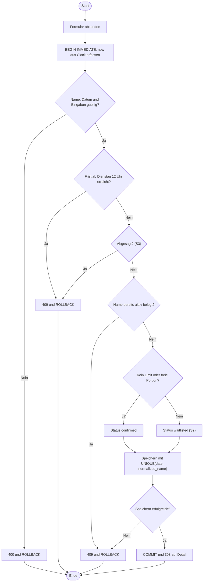

# Aktivitätsdiagramm: Anmeldung (geplant)
Alle Schritte sind geplant. S2 (Limit/Warteliste) und S3 (Absage) sind Should-Umfang.

Frist und Zustand werden vor der fachlichen Änderung innerhalb der Transaktion geprüft; vorab sichtbare UI-Sperren ersetzen diese Prüfung nicht. Köche belegen nur über ihre separate bestätigte Essen-Anmeldung Portionen. Eine vor Frist stornierte Anmeldung darf nach Pflichtenheft denselben Schlüssel reaktivieren.
