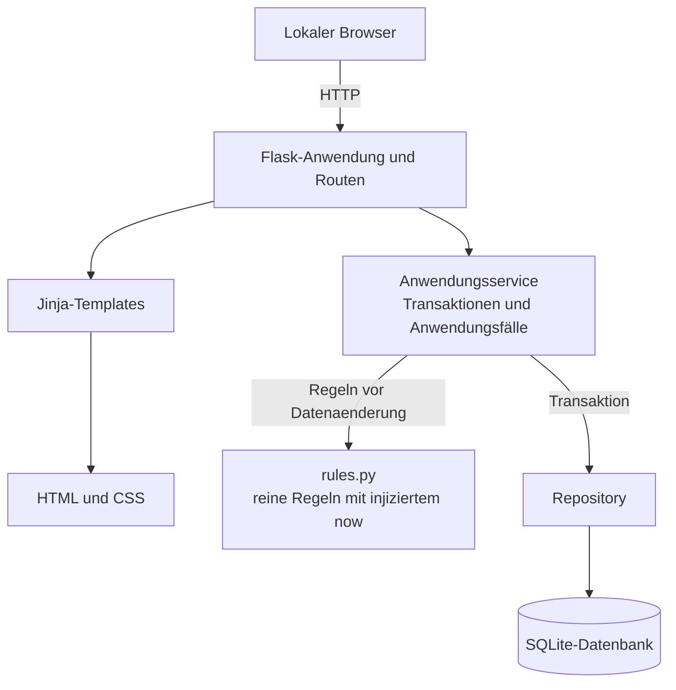

# Architektur (geplant)

Dieses Diagramm beschreibt den vorgesehenen Aufbau der Webapp **Der kulinarische Mittwoch**. Es ist Planungsdokumentation; die Architektur ist nicht implementiert.

Flask rendert die Seiten serverseitig mit Jinja. Der Service orchestriert Änderungen, prüft die Geschäftsregeln und führt Datenbankänderungen über das Repository transaktional aus. `rules.py` bleibt frei von Flask- und Datenbankzugriffen; die aktuelle Zeit wird injiziert, damit die Dienstag-12:00-Grenze in Europe/Berlin eindeutig geprüft werden kann. Der Kalender kann zukünftige Mittwoche unbegrenzt berechnen; ein Mittwoch-Datensatz wird erst bei der ersten Änderung angelegt.

**Optionale Should-Features** sind in diesem Architekturentwurf nicht als gebaut zu verstehen. Keine Authentifizierung ist vorgesehen.
