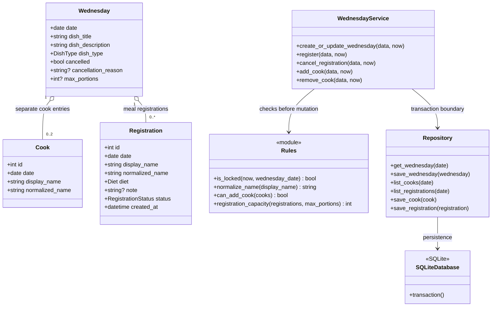

# Klassendiagramm (geplant)

Das Diagramm zeigt die Verantwortlichkeiten des vorgesehenen Entwurfs. Es ist keine Beschreibung vorhandener Implementierungsklassen.

`Rules` erhält `now` als Eingabe und entscheidet die Sperre an der exakten Grenze Dienstag 12:00 Europe/Berlin vor dem zugehörigen Mittwoch. Der Service prüft die Sperre innerhalb der Transaktion vor jeder fachlichen Datenänderung und führt alle zustandsabhängigen Prüfungen und Änderungen atomar aus. Datenbank-UNIQUE-Bedingungen auf `(date, normalized_name)` sichern parallele oder doppelte Einträge zusätzlich ab. Köche zählen nicht automatisch als Essensanmeldungen.

Die Warteliste und das FIFO-Nachrücken sind optionale Should-Features und werden hier nicht als umgesetzt dargestellt.
