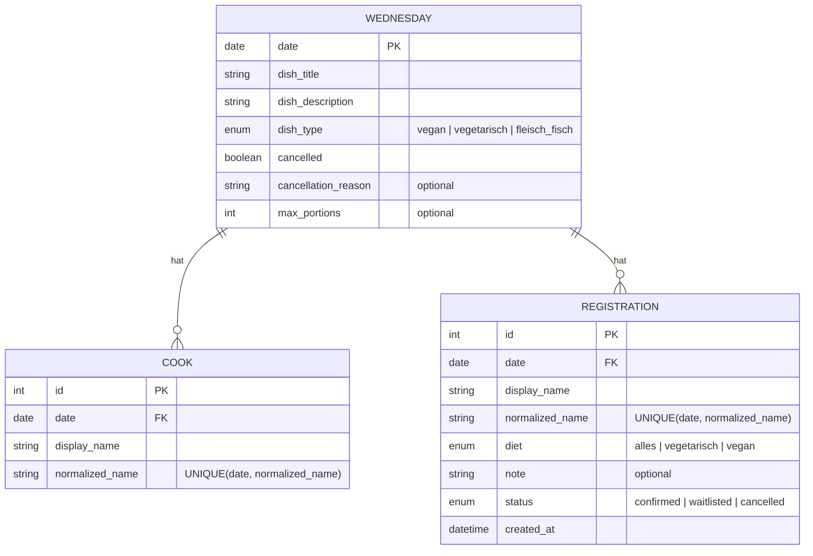

# ER-Diagramm (geplant)

Das Modell bildet Mittwochstermine, separat erfasste Köche und Essensanmeldungen ab. Es beschreibt den geplanten Datenbestand, nicht eine bereits gebaute Datenbank.

Ein Cook-Datensatz bedeutet **keine** Essensanmeldung und wird nicht auf die Portionszahl angerechnet. Wer als Koch mitessen möchte, benötigt zusätzlich eine `REGISTRATION`. Pro Mittwoch sind höchstens zwei Köche erlaubt; die Prüfung erfolgt innerhalb der Service-Transaktion. `normalized_name` wird durch Trimmen und Casefolding gebildet. Namensvetter müssen einen unterscheidenden Zusatz verwenden.

Eine Absage setzt den Mittwoch auf abgesagt und erhält die zugehörigen Datensätze lesbar. Eine Warteliste ist ein optionales Should-Feature: FIFO-Nachrücken bei frei werdenden Portionen ist nur vor der Anmeldefrist vorgesehen.
