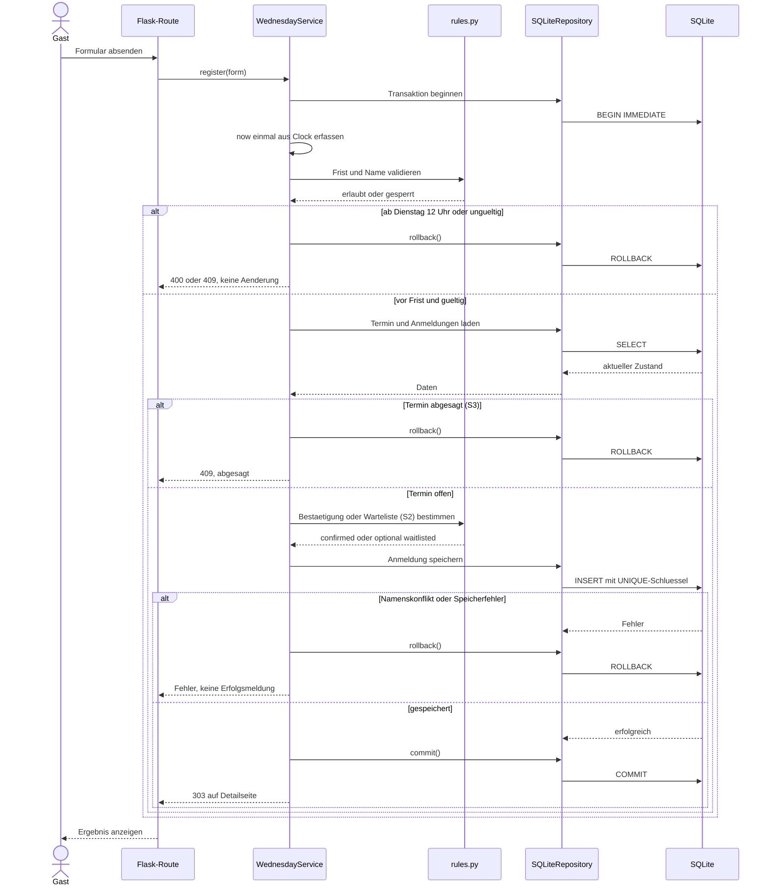

# Sequenzdiagramm: Anmeldung (geplant)
Planungsstand; keine implementierte Funktion. Zeit, Absage und Integrität werden serverseitig geprüft.

Die Fristprüfung liegt innerhalb der Schreibtransaktion vor jeder fachlichen Datenänderung. UNIQUE(date, normalized_name) verhindert Doppelanmeldungen auch bei parallelen Anfragen. Ohne S2 besteht kein Portionslimit; mit S2 zählt ausschließlich confirmed für den Einkauf. Warteliste/Absage sind Should-Umfang und hier keine Fertigmeldung.
